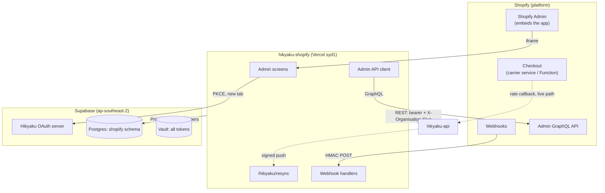
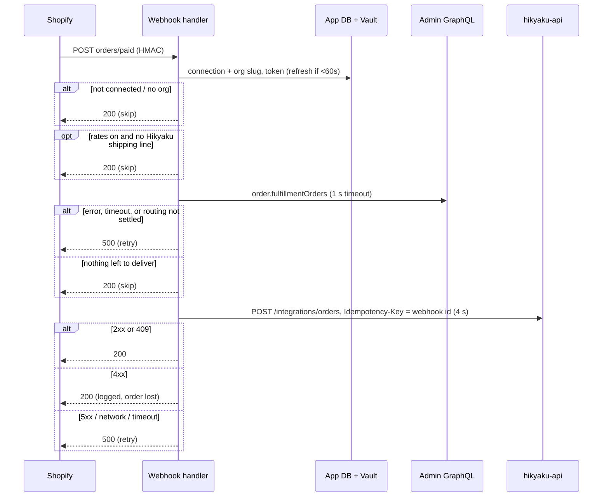

# How hikyaku-shopify integrates with Shopify

A high-level overview for anyone building another Hikyaku e-commerce connector (e.g. WooCommerce). It covers what this app does, the contract it keeps with `hikyaku-api` (which a new connector shares), how each piece maps onto Shopify, and the gotchas we hit. Shopify specifics are called out so you can tell what is platform glue and what is Hikyaku's contract.

AGENTS.md has the file-by-file detail; this document is the "why" and the lessons.

---

## 1. What the app is

`hikyaku-connect` is a Shopify embedded app (React Router + Polaris web components, hosted on Vercel `syd1`, Postgres in the same Supabase project as `hikyaku-api`, in its own `shopify` schema). It is a thin bridge:



Editable version: [shopify-integration-architecture.drawio](shopify-integration-architecture.drawio).

It does five jobs:

1. **Connect** a store to a Hikyaku account and organisation (Hikyaku OAuth).
2. **Forward paid orders** to Hikyaku as delivery jobs, split by the location that ships each item.
3. **Keep Hikyaku told about routing changes** after payment (items moved between locations, cancelled, etc.).
4. **Map store locations to Hikyaku warehouses** (and keep the list in sync).
5. **Offer Hikyaku delivery rates at checkout**, priced by `hikyaku-api`.

Plus: back-filling orders paid before the store was connected, and the platform's mandatory lifecycle/privacy hooks.

The app stores almost nothing itself: tokens (in Vault), which Hikyaku org a shop feeds, and a record of what it created in the shop for checkout rates. Location mappings, rate settings, orders and packages all live in `hikyaku-api`.

---

## 2. Two separate credential flows

Don't confuse these; a WooCommerce plugin will have the same split.

| | Platform credential | Hikyaku credential |
| --- | --- | --- |
| Purpose | App talks to the store | App talks to `hikyaku-api` on behalf of a Hikyaku user |
| Shopify impl | Shopify OAuth via `@shopify/shopify-app-react-router`; offline token per shop | OAuth 2.1 + PKCE against Hikyaku's Supabase OAuth server (`app/lib/hikyaku-oauth.server.ts`) |
| Storage | `Session` row; tokens in Supabase Vault, row holds only secret UUIDs | `HikyakuConnection` row; tokens in Vault, row holds only secret UUIDs |

**Hikyaku OAuth details worth reusing:**
- Confidential client, `client_secret_basic`, scope `email profile`. Redirect URI is derived from the app URL (`/hikyaku/callback`) and must be registered byte-for-byte in Supabase.
- PKCE state is persisted (`HikyakuOAuthState`), single-use (delete-then-check so concurrent callbacks can't both win), expires after 10 minutes.
- **Supabase rotates the refresh token on every refresh.** Always persist the new refresh token, not just the access token. Refresh when within 60 s of expiry.
- Identity is fetched from `GET /auth/v1/user` (with the anon `apikey` header) instead of `openid`/id_token, which would need asymmetric JWT signing enabled on the project.
- The consent screen can't render inside the Shopify admin iframe, so the flow opens in a new tab. (Check whether your platform's admin has a similar framing restriction.)
- After OAuth the merchant **picks an organisation** (`GET /api/v1/organisations/me`); the slug is sent as `X-Organisation-Slug` on every later call. A connection without an org is treated as "not connected" by the webhooks.

---

## 3. The contract with hikyaku-api (platform-agnostic)

**The source of truth is hikyaku-api's Swagger docs:** <https://api.hikyaku.org/api-docs> (OpenAPI JSON at `/api-docs-json`; locally `http://localhost:3002/api-docs`, or `openapi.json` in the `hikyaku-api` repo). This section is a summary of how this app uses it; where they disagree, Swagger wins.

Every call: `Authorization: Bearer <hikyaku access token>`, `X-Organisation-Slug: <slug>`. Identify the store with `platform: "shopify"` + `shop_domain` (a WooCommerce connector would use its own platform slug and store identifier; agree on these with the API side).

| Call | Purpose |
| --- | --- |
| `GET /api/v1/organisations/me` | Orgs the user can feed |
| `POST /api/v1/integrations/orders` | Order events (`order.paid`, `order.fulfillment_updated`). `Idempotency-Key` = event id |
| `GET /api/v1/integrations/orders?platform=…&external_order_ids=…` | Which orders Hikyaku already has (≤100 ids, needs `packages.view`) |
| `GET /api/v1/warehouses` | Org's warehouses (for mapping) |
| `GET`/`PUT /api/v1/integrations/locations` | Store locations ↔ warehouses |
| `GET`/`PUT`/`DELETE /api/v1/integrations/shipping-rates` | Checkout rate settings + priced service catalog |
| `GET /api/v1/integrations/shipping-rates/static-plan` | Precomputed rate table + coverage, for stores that can't call out at checkout |

### 3.1 `order.paid` event

Built by the pure `buildOrderPaidEvent` (`app/lib/order-event.server.ts`). Shape (abridged):

```jsonc
{
  "event":  { "id": "<unique, stable per delivery>", "type": "order.paid", "occurred_at": "...", "api_version": "..." },
  "source": { "platform": "shopify", "shop_domain": "...", "app_version": "0.1.0" },
  "order":  { "id": "<platform order id>", "legacy_id": 123, "name": "#1001", "currency": "AUD",
              "total_price": "...", "total_shipping": "...", "tags": [], "total_weight_grams": 0,
              "line_items": [{ "id": "<string>", "title": "...", "sku": "...", "quantity": 1, "price": "...", "grams": 0, "requires_shipping": true }] },
  "customer": { "id": "...", "first_name": "...", "last_name": "...", "email": "...", "phone": "..." },
  "delivery": { "required": true, "recipient_name": "...", "phone": "...", "email": "...",
                "address": { "line1": "...", "line2": "...", "city": "...", "province": "...", "province_code": "...",
                             "postcode": "...", "country": "...", "country_code": "AU", "company": "..." },
                "latitude": null, "longitude": null, "shipping_method": "...", "instructions": "<order note>" },
  "fulfillment_groups": [ /* see below; never empty */ ],
  "shipping_rate": { /* only when the shopper picked a Hikyaku rate; omitted otherwise, never null */ }
}
```

- `delivery.required` = has a shipping address **and** at least one line requiring shipping (Shopify has no single flag).
- Lat/lng are almost always null; geocoding is the backend's job.
- Money is decimal strings, in the order currency.

### 3.2 Fulfillment groups (the important bit)

```ts
{ id: "<fulfillment unit id>", external_location_id: "<location id, same as sent to /locations>",
  external_location_name, delivery_method: "shipping" | "local" | "pickup" | "none",
  line_items: [{ line_item_id: "<same string as order.line_items[].id>", quantity }],
  total_weight_grams: number | null }   // null if any line lacks a weight
```

**Never send an order without groups.** Hikyaku would then dispatch the whole order from its nearest warehouse. If routing isn't known yet, fail and retry rather than send. Quantities are what's still left to fulfil, not what was ordered.

In Shopify a group is a *fulfillment order*. Statuses `OPEN`/`IN_PROGRESS`/`ON_HOLD` become groups; `CLOSED`/`CANCELLED`/`INCOMPLETE`/`SCHEDULED` are skipped; if nothing is left, the order isn't sent at all. Your platform will need its own answer to "which location ships which items" — for a single-location store that's one group with every shippable line.

### 3.3 `order.fulfillment_updated`

Sent when routing changes after payment. Carries only `order { id, name }`, **all** current groups (possibly empty), and `released_group_ids` (groups the change took items away from). Hikyaku takes recipient/line items from the `order.paid` it already has, replaces/drops/creates packages accordingly. A group that disappears without being released (i.e. fulfilled) keeps its package.

### 3.4 Locations

`PUT /api/v1/integrations/locations` with `{ platform, shop_domain, locations: [...], mark_missing_stale? }`. Each location: `external_location_id`, name, `country_code` (ISO), street `address`, and optionally `mode` (`warehouse` | `not_delivered` | `unmapped`) + `warehouse_id`.
- Omit `mode` to keep the stored mapping (new ones arrive `unmapped`). Send `mode` only when the merchant changed a picker.
- Send `mark_missing_stale: true` only with the store's **complete** list.
- The street address matters: a checkout rate callback names its origin only by address, and `hikyaku-api` matches it against these.

### 3.5 Error handling contract

`postOrderEvent` maps API responses onto the platform's webhook retry semantics:

| hikyaku-api | Meaning | Webhook answer |
| --- | --- | --- |
| 2xx or 409 | accepted / already processed | 200 (done) |
| 4xx | request wrong, auth, permission | 200 (retrying won't help; log it) |
| 5xx, network error, timeout | transient | 500 (ask the platform to retry) |

The whole `orders/paid` path, with every status it can answer:



Other calls return `{ ok, retry, status, detail, code?, serviceIds? }`. Errors are NestJS-shaped (`message` may be an array); 422s on rate settings carry a machine `code` (`stripe_not_connected`, `no_services`, `service_missing_currency`, `unknown_service`, `band_settings_invalid`, `too_many_rates`) and `service_ids`; 409 on rates means another org holds the store; 401 → "reconnect"; 403 → the Hikyaku user lacks a permission.

### 3.6 Permissions are checked by trying

The API can't report the caller's permissions. The app treats a 403 as the answer and degrades: e.g. Locations falls back to read-only (`GET` instead of the syncing `PUT`) with a "View only" banner. Relevant permissions: `warehouse.view`, `integrations.locations.write`, `packages.view`, `integrations.shipping_rates.write`.

### 3.7 Resync push (API → app)

`hikyaku-api` POSTs `/hikyaku/resync` when something behind a store's static rates changes. Signed with a shared secret: `X-Hikyaku-Timestamp` (unix s) and `X-Hikyaku-Signature: sha256=<hex HMAC(secret, "<ts>.<raw body>")>`, ±5 min window, constant-time compare. Body `{ platform, shop_domain, reasons }`. Answer 500 on failure so it retries. A new connector needs its own endpoint (and probably its own secret).

---

## 4. How each feature maps onto Shopify

| Feature | Shopify mechanism | Notes |
| --- | --- | --- |
| Order intake | `orders/paid` webhook (HMAC-verified) | Fires once. 5 s budget: 1 s for the Admin read, 4 s for the POST |
| Routing | Admin GraphQL `order.fulfillmentOrders` | Needs `read_merchant_managed_fulfillment_orders` |
| Re-routing | `fulfillment_orders/moved|split|merged|cancelled|scheduled_fulfillment_order_ready` | Payloads name only fulfillment orders; app queries back to the order |
| Locations | Admin `locations` query + `locations/*` webhooks | Only `isActive && fulfillsOnlineOrders` are mapped by default |
| Back-fill | Admin `orders` search; send as `order.paid` with `Idempotency-Key: import:<order id>` | Shopify only exposes the last 60 days without `read_all_orders` |
| Checkout rates, live | Carrier service: Shopify calls `hikyaku-api` directly at checkout | Only on some plans |
| Checkout rates, static | App writes rate rows into delivery profiles + a delivery-customization Function filters them per address | For plans without carrier services |
| Plan/currency change | `shop/update` webhook → re-check path | |
| Lifecycle | `app/uninstalled`, `shop/redact`, `customers/*` | Mandatory; see gotchas |

### Checkout rates in more detail

The heavy part of the app. Two paths exist only because Shopify gates carrier-calculated shipping by plan:

- **Live:** register a carrier service whose callback is `hikyaku-api`'s rate endpoint. Shopify sends cart + destination + origin address; `hikyaku-api` answers with rates. Rate `service_code` = `hikyaku:<service_id>`, which comes back on the order's shipping line `code`, so `orders/paid` can tell a Hikyaku rate.
- **Static:** fetch `static-plan` (flat / distance-band / weight-band rates per service + a coverage export), write each rate as a named shipping method (`Hikyaku · <service>[ · <band>]`), and let a Function hide the ones that don't fit the destination (distance band, coverage polygon, currency). The app owns everything with that name prefix and nothing else; a resync is a full reconcile.
- With rates **on**, only orders that chose a Hikyaku rate are forwarded (others ship another way), and the event carries `shipping_rate { service_id, path, price, discounted_price, currency, title }`. With rates off, every paid order is forwarded.
- Rate codes: `hikyaku:<service_id>`, `…:d:<min>-<max>` (distance, service unit), `…:w:<min_g>-<max_g>` (weight).

If WooCommerce lets a plugin compute rates server-side at checkout, you likely need only the live-style path (call `hikyaku-api` for rates) and none of the static machinery. Confirm with the API side which endpoint a non-Shopify connector should call; the current carrier endpoint (`/api/v1/integrations/shopify/carrier-rates`) is Shopify-specific and verifies Shopify's HMAC.

---

## 5. Gotchas

### Contract / hikyaku-api
- **hikyaku-api rejects unknown fields** (`whitelist` + `forbidNonWhitelisted`). Any field the deployed API's DTO doesn't know returns 400. Since 4xx means "don't retry", **an unknown field silently loses orders.** Deploy the API change first, and **omit** optional fields rather than sending `null`. (Caught before `shipping_rate: null` and location `address` went to production.)
- **Idempotency:** the event id is the `Idempotency-Key`. Use something stable per platform delivery (Shopify's webhook id) so retries dedupe, and a deterministic key for back-fills (`import:<order id>`) so importing twice records once.
- **Line item ids must match exactly** between `order.line_items[].id` and `fulfillment_groups[].line_items[].line_item_id` (both strings). Lines routed but missing from the payload are dropped from groups (and logged), since the API rejects the whole event otherwise.
- **Country formats differ:** warehouses carry a country *name* ("Australia"), locations an ISO code ("AU"). Resolve names via `Intl.DisplayNames` + an alias list; never match an unrecognised name.
- Weights go out in grams; convert from the platform's units, and send `null` rather than guessing when a weight is missing.

### Reliability
- **Treat the webhook response as a retry contract.** 500 = retry, 200 = done. Decide deliberately per branch; "not connected to Hikyaku" and "nothing to deliver" are 200, "routing not settled" and "upstream 5xx" are 500.
- **Mind the platform's webhook timeout** (Shopify: 5 s). Budget each outbound call with explicit timeouts.
- **Order-paid fires once.** Orders paid before connecting (or while disconnected) never arrive — hence the back-fill screen and the Home banner counting missing orders.
- **Partial / held / scheduled orders:** only send what's still to ship. Dropping an on-hold order loses it forever (nothing tells Hikyaku when the hold lifts). Sending scheduled (subscription) deliveries would dispatch them all at once.
- Known gap: an order whose every fulfillment unit was scheduled at payment never reached Hikyaku, so its later "ready" update is skipped.

### Lifecycle & data
- **Uninstall cleanup can't call the platform:** after uninstall the app has no token. Shopify keeps the shipping methods the app wrote, so merchants must remove rates **before** uninstalling (the UI says so). Also, late `app/uninstalled` retries can arrive after a reinstall — check the app is actually still uninstalled before deleting anything.
- Shopify's SDK refreshes expiring tokens before running the uninstall webhook handler, which fails once uninstalled; those webhooks are HMAC-verified manually instead (`webhook-verification.server.ts`).
- Delete secrets through the storage layer, never raw row deletes, or Vault secrets are orphaned.
- The app persists **no customer data**; order PII is only forwarded. Hikyaku holds it as the merchant's processor, so privacy requests are handled in Hikyaku. Shopify requires Level 2 protected-customer-data approval to publish because of the name/address/phone/email in orders.
- Disconnect order: remove what the app created in the store first (while the store token works), then delete `hikyaku-api` rate settings (best effort, while the Hikyaku token works), then local rows and secrets.

### Infra
- Database: runtime connects through Supabase's transaction pooler (6543, `connection_limit=1`) as a least-privilege role (`hikyaku_shopify`) that can only touch its own schema and Vault via wrapper functions tagging secrets `hikyaku-shopify`. Migrations run from a dev machine via the direct URL, never in the deploy build. A WooCommerce backend sharing this Supabase project should get its **own schema, role and Vault tag**.
- Host functions near the DB (`syd1` ↔ `ap-southeast-2`); token refreshes take several round trips and crossing the Pacific made them slow.
- Never ask the merchant to type their store domain (Shopify App Store rule 2.3.1); installs start from the platform. Hikyaku's "Connected Apps" page starts a Shopify install via `/auth/login?shop=…`.

---

## 6. Design patterns worth copying

- **Pure core, thin I/O.** Every transform (event building, fulfillment groups, location suggestions, rate code parsing, static plan diffing, form validation) is a pure, unit-tested module; route handlers only read, call and decide the status code.
- **Sync is reconcile, not append.** On every Locations load, re-list everything and upsert with `mark_missing_stale`; webhooks upsert the one changed item without touching its mapping.
- **Suggestions never save themselves.** The nearest-warehouse suggestion (same country, ≤5 km haversine) only preselects the picker; Save persists.
- **Own things by name prefix** when the platform has no "created by app" marker, and reconcile them fully on each sync.
- **Fail closed** at checkout: if coverage/rates data is missing or malformed, hide Hikyaku rates rather than show wrong ones.
- **Old path down before new path up**, so two rate mechanisms never show at once; record the last error and show it until a retry succeeds.

---

## 7. Questions a new connector has to answer

1. What's the stable store identifier sent as `shop_domain`, and what `platform` slug? (Agree with hikyaku-api.)
2. Which event marks an order as paid, does it fire once, and what are its retry/timeout semantics?
3. How does the platform tell you which location ships which items (multi-location / inventory plugins)? Single-location fallback?
4. What ids do orders, line items and locations have, and are they stable?
5. How are partial fulfilment, holds, cancellations, and subscription renewals represented?
6. Can the plugin compute shipping rates at checkout server-side (live path only), and which hikyaku-api endpoint serves a non-Shopify rate request?
7. Where do Hikyaku tokens live, and how is the OAuth redirect handled (plugin runs on the merchant's server vs. a hosted backend)? This changes the storage and secret story entirely compared with this app.
8. What happens on plugin deactivation/uninstall, and can you still clean up then?

---

## 8. Working conventions (from this project)

- Linear epics get their own branch (cut from `main`); sub-issue branches come off the epic branch and merge back `--no-ff` ("Merge <what> (HIK-xxx) into HIK-yyy"), not into `main`.
- Move Linear issues as work progresses: In Progress when starting, Review once merged into the epic branch (before QA/push), Done when shipped.
- Before pushing app changes that add request fields, confirm the deployed hikyaku-api accepts them (see the unknown-fields gotcha). The production Swagger docs show what's deployed.
